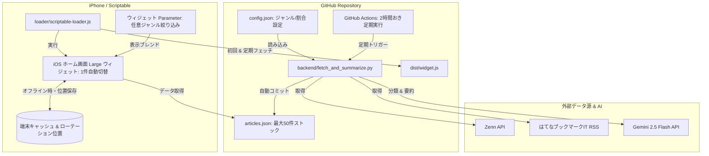

# IT Trend Scriptable Widget 📱⚡

iPhoneの「**Scriptable**」アプリで動作する、IT系トレンド記事（はてなブックマークIT & Zennトレンド）の自動取得＆AI要約（Gemini 2.5 Flash）ホーム画面ウィジェットです。

iCloudを使用せず、**GitHubリポジトリ + GitHub Actions** 経由でiPhone側に最新データとコードを同期・配信します。

---

## ✨ 主な機能

- **たっぷり収集（最大50件）・新着優先 ＆ 1件ずつ自動ローテーション表示:**
  - はてなブックマークIT（人気＋新着）および Zenn（トレンド＋デイリー）から、公開日時の新しい記事を優先して**最大50件**収集し、Largeサイズウィジェットに**1記事を大きく見やすく**（タイトル最大3行 + 一言キャッチ + 詳細AI要約 + 公開日時）表示します。
  - ウィジェット更新のたびに端末内のローテーション状態が進み（デフォルト最小切替間隔 `ROTATION_INTERVAL_MINUTES = 10` 分）、自動で次の記事へ切り替わります。下部には次に切り替わる記事の予告（`NEXT ▸`）を表示します。
- **複数ジャンルの選択 ＋ 他ジャンルの取りこぼし防止:**
  - 5つの技術ジャンル（`ai`, `web`, `infra`, `mobile`, `biz`）＋ 総合（`other`）に対応。
  - リポジトリの `config.json` および iPhoneウィジェットの `Parameter` の両方で優先ジャンルを複数指定できます。
  - **他ジャンル取りこぼし防止（セレンディピティ枠）**: 特定ジャンルに絞った場合でも、完全に他ジャンルを排除せず**全体の25%（4件に1回）は選択外ジャンルの高注目トレンド記事**を自動で混ぜて表示します（ウィジェット上では `✨ 注目トレンド枠` バッジが付きます）。

---

## 🏗 全体アーキテクチャ



---

## 📁 ディレクトリ構成

```text
IT_trend_checker/
├── .github/workflows/
│   └── update-news.yml           # 2時間おきに実行されるGitHub Actions
├── backend/
│   ├── fetch_and_summarize.py    # はてブ & Zenn取得、並列本文抽出、Gemini分類・要約
│   └── requirements.txt          # Python依存ライブラリ
├── frontend/
│   └── src/
│       └── index.ts              # Scriptable用TypeScriptウィジェットコード
├── loader/
│   └── scriptable-loader.js      # iPhone側Scriptableに1回だけ登録するローダー
├── dist/
│   └── widget.js                 # バンドル済みJS（esbuildで生成）
├── config.json                   # 収集件数・優先ジャンル・他ジャンル保証割合の設定
├── articles.json                 # 自動更新される記事要約データ
├── package.json
├── tsconfig.json
└── README.md
```

---

## 🏷 対応ジャンル一覧

| キー | ジャンル名 | 主な対象 |
| :--- | :--- | :--- |
| `ai` | AI・LLM・機械学習 | 生成AI、LLM、エージェント、機械学習、RAG等 |
| `web` | Web開発・言語 | フロントエンド、バックエンド、TypeScript、Rust、Go等 |
| `infra` | インフラ・クラウド・セキュリティ | AWS/GCP、Kubernetes、DB、CI/CD、セキュリティ等 |
| `mobile` | モバイル・ガジェット・個人開発 | iOS/Android、個人開発サービス、ハードウェア/IoT等 |
| `biz` | ITビジネス・キャリア・マネジメント | エンジニア組織、開発手法、キャリア、設計論等 |
| `other` | 総合・その他IT | 上記に分類されない総合的なIT・テック話題 |

---

## ⚙️ ジャンル選択の設定方法

### A. リポジトリ全体での設定（`config.json`）
ルートの `config.json` を編集することで、GitHub Actions での収集件数やデフォルトの優先ジャンル・他ジャンル保証割合を調整できます。

```json
{
  "total_articles": 50,
  "max_age_hours": 72,
  "sources": {
    "hatena_hot_limit": 25,
    "hatena_new_limit": 20,
    "zenn_limit": 35
  },
  "selected_genres": ["ai", "web", "infra", "mobile", "biz"],
  "other_genre_min_ratio": 0.25
}
```
- `total_articles`: ストックする最大記事数（デフォルト `50`）。
- `max_age_hours`: 新着として最優先する経過時間（デフォルト `72` 時間以内）。
- `selected_genres`: 優先的に集めたいジャンルのキー配列。
- `other_genre_min_ratio`: 選択外ジャンルを最低限確保する割合（`0.25` ＝ 全体の25%以上は他ジャンルの注目記事を残す）。
- 切替速度の調整: `frontend/src/index.ts` 先頭の `ROTATION_INTERVAL_MINUTES`（デフォルト `10` 分）を変更して `npm run build` すると、ホーム画面上の最小切替間隔を変更できます。

### B. iPhoneウィジェット側の `Parameter` によるリアルタイム絞り込み
iPhoneのホーム画面でウィジェットを長押し ＞「**ウィジェットを編集**」＞「**Parameter**」欄にジャンルを入力すると、コードやGitHub側の設定を書き換えずに手元で表示をカスタマイズできます。

- **未入力** または `all`: 全ジャンルをバランスよくローテーション表示
- **カンマ区切りで複数指定**（例: `ai,web` や `AI,インフラ`）:
  - 指定したジャンルをメイン（3件）にしつつ、**4件に1回は他ジャンルの注目記事が「✨ 注目トレンド枠」として必ず混ざる**ため、専門外の大ニュースを取りこぼしません。
  - ホーム画面に2つウィジェットを置き、片方は `ai,web`、もう片方は `infra,biz` のように使い分けることも可能です。

---

## 🚀 セットアップ手順

### 1. GitHubリポジトリの作成とプッシュ
1. 本プロジェクトをGitHubリポジトリにプッシュします。
2. リポジトリの **Settings > Secrets and variables > Actions** を開きます。
3. `New repository secret` をクリックし、以下を登録します:
   - **Name:** `GEMINI_API_KEY`
   - **Secret:** Google AI Studio等で取得したGemini APIキー

> **Note**: GitHub Actionsの定期実行（`update-news.yml`）にはリポジトリへの書き込み権限が必要です。  
> **Settings > Actions > General > Workflow permissions** で `Read and write permissions` が有効になっていることを確認してください。

---

### 2. URLの書き換え設定

リポジトリ作成後、以下のファイル内のプレースホルダーURLをご自身のリポジトリに合わせて変更してください。

#### ① `frontend/src/index.ts`
```typescript
const GITHUB_RAW_JSON_URL = "https://raw.githubusercontent.com/<ユーザー名>/<リポジトリ名>/main/articles.json";
const GITHUB_TOKEN = ""; // Privateリポジトリの場合は Personal Access Token (repo権限) を指定
```

#### ② `loader/scriptable-loader.js`
```javascript
const WIDGET_SCRIPT_URL = "https://raw.githubusercontent.com/<ユーザー名>/<リポジトリ名>/main/dist/widget.js";
const GITHUB_TOKEN = ""; // Privateリポジトリの場合は上記と同じトークンを指定
```

> **変更後は必ずPC側で再ビルドしてGitHubへプッシュしてください:**
> ```bash
> npm run build
> git add .
> git commit -m "feat: configure repository URLs and build widget"
> git push
> ```

---

### 3. iPhone側（Scriptable）への登録

1. iPhoneにApp Storeから「**Scriptable**」アプリをインストールします。
2. Scriptableアプリを開き、右上の **「+」** をタップして新規スクリプトを作成します。
3. タイトルを「`IT Trend Loader`」等に変更します。
4. 本リポジトリの `loader/scriptable-loader.js` の内容をコピーし、エディタに貼り付けます。
5. 右下の再生ボタン（▶）をタップしてテスト実行し、Largeサイズのプレビューが表示されることを確認します。実行するたびに次の記事へ切り替わります。
6. iPhoneのホーム画面長押し ＞ 左上の「+」 ＞ **Scriptable** を選択 ＞ **Large（大サイズ）** を追加します。
7. ウィジェットを長押し ＞ **「ウィジェットを編集」** を選択:
   - **Script:** `IT Trend Loader` を選択
   - **Parameter:** （任意）絞り込みたいジャンルを入力（例: `ai,web` ／ 空欄で全ジャンル）
   - **When Interacting:** `Open URL`（記事カードや下部 `NEXT ▸` をタップするとブラウザが開きます）

---

## 🛠 開発用コマンド

- **パッケージインストール:**
  ```bash
  npm install
  ```
- **型チェック & TypeScriptビルド（単一ファイルバンドル）:**
  ```bash
  npx tsc --noEmit
  npm run build
  ```
- **変更監視（watch）モード:**
  ```bash
  npm run dev
  ```
- **ローカルでバックエンドスクリプトを実行テスト:**
  ```bash
  pip install -r backend/requirements.txt
  python backend/fetch_and_summarize.py
  ```
